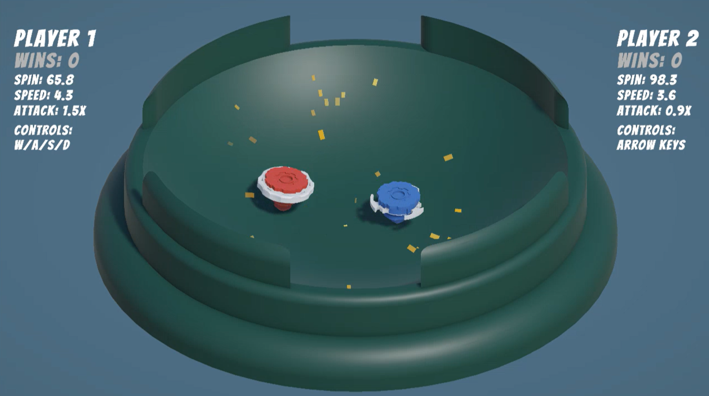
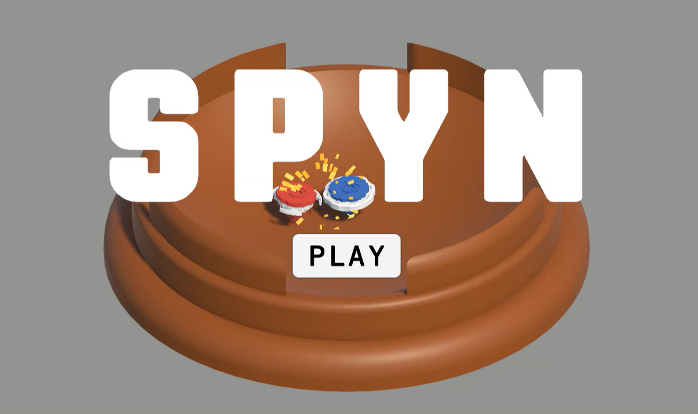
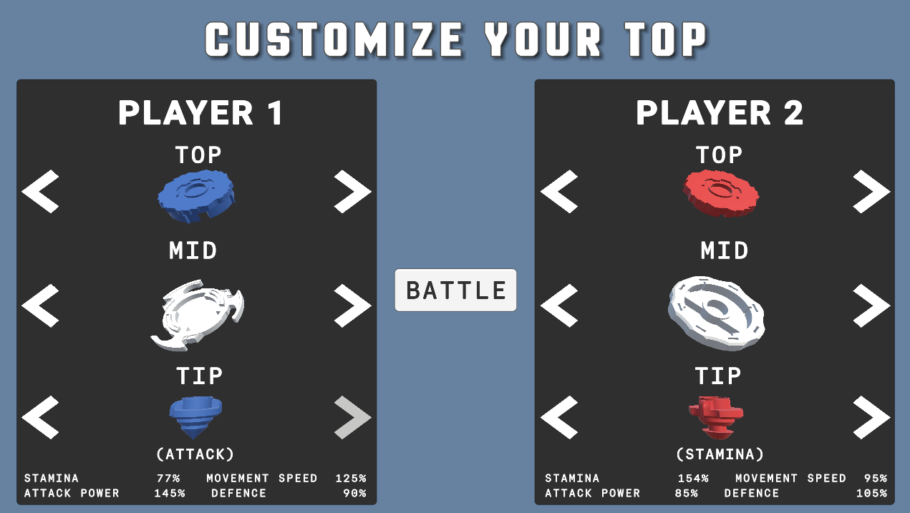

# Spyn

Customize your Spyner and battle in an arena! Like Beyblade!

A **local 2-player ** game where you battle 1v1 against your friend with your custom Spyner in an arena!

**Play here:** https://irtaza.itch.io/spyn

The game is built completely from scratch in Unity! All assets and 3d models have been made by us!!

## Demo Video

## Demo Images

## Controls

- Choose your spyner parts (top, mid and tip). Each tip has different stats!
- Player 1 controls their spyner with **W/A/S/D**.
- Player 2 controls their spyner with **arrow keys**.
- Knock the other spyner out of the arena, or be the last spyner spinning inside the arena to win!!

## Credits

Made by [Irtaza](https://github.com/Irtaza2009) and [Aayan](https://github.com/MuhammadAayanMirza)!

Our submission for **Thirdspace** week 4!
